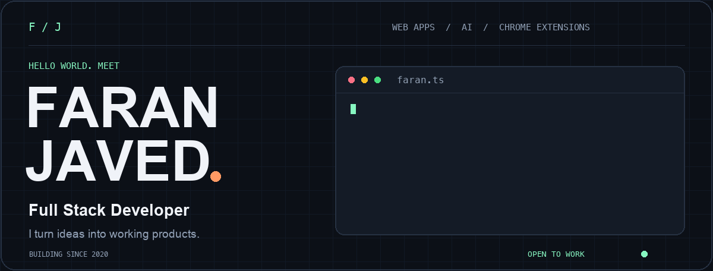
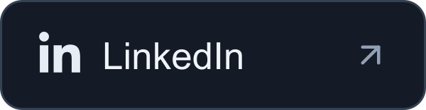
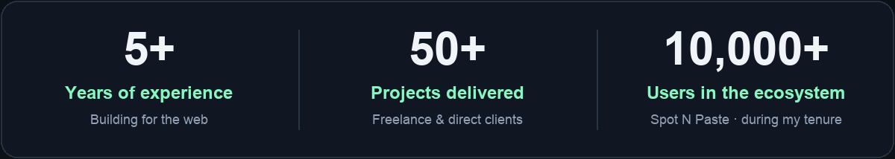
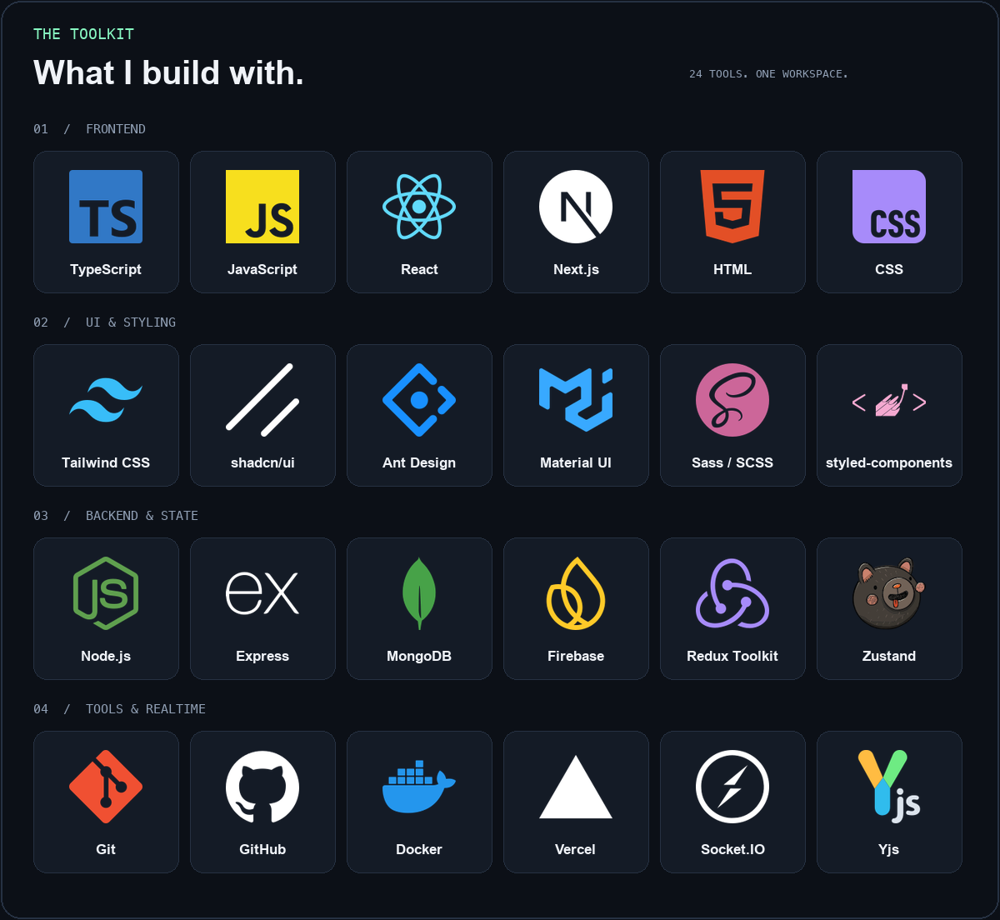
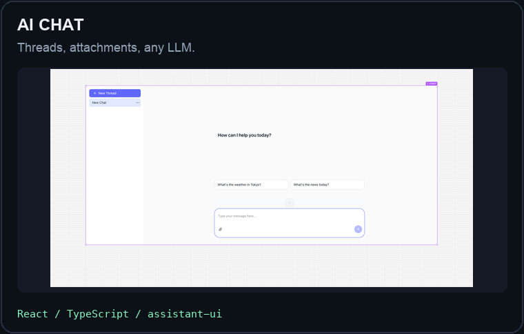
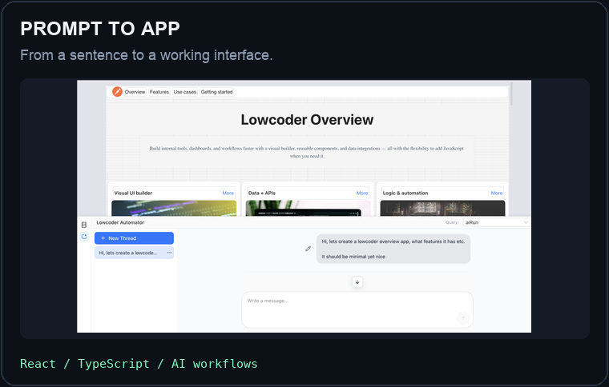
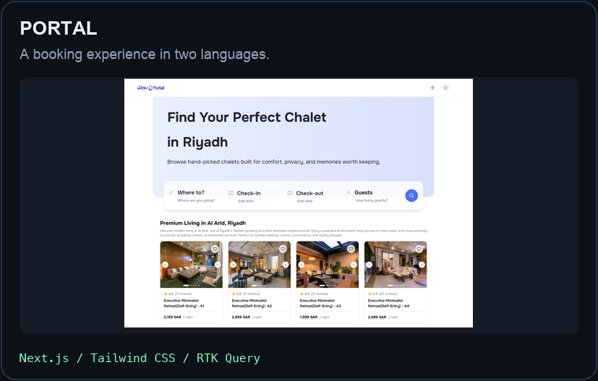
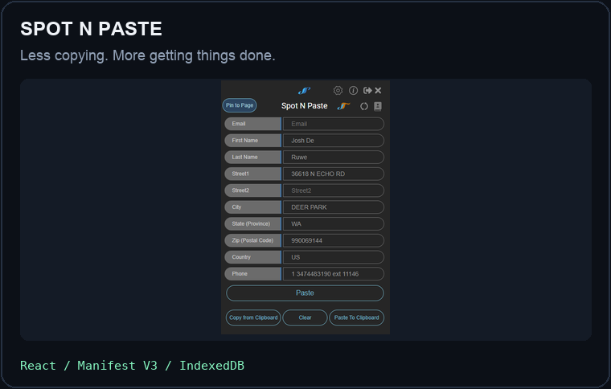
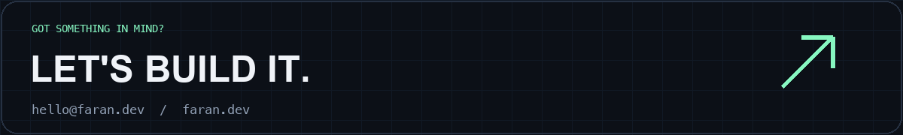

<div align="center">
  
  <br /><br />
  <a href="https://faran.dev"></a>
  &nbsp;
  <a href="https://www.linkedin.com/in/faranjaved/"></a>
  &nbsp;
  <a href="mailto:hello@faran.dev"></a>
</div>

<br />



<br />

## 01 / Behind the commits

I'm **Faran**, a CS graduate and **Full Stack Developer** who likes making complicated workflows feel simple. I build web apps, AI interfaces, and Chrome extensions — and I enjoy getting into an existing codebase and figuring out what needs fixing.

Right now, I'm working at **[Lowcoder](https://github.com/lowcoder-org/lowcoder)**, an open-source low-code platform. My work includes AI chat, a natural-language app builder, contextual coding assistance, and real-time collaboration.

- 🧠 **Building:** AI features that work inside real products, from conversation threads to prompt-driven app creation.
- ⚡ **Connecting:** Real-time experiences with Yjs, HocusPocus, WebSockets, and Socket.IO.
- 🧩 **Automating:** Browser workflows with Chrome extensions, Manifest V3, and IndexedDB.
- 🛠️ **Improving:** Production apps, UI systems, API integrations, and the bugs in between.
- 🔌 **Away from the editor:** Probably checking out a new piece of tech.

**Open to full-time roles and freelance work.** [Let's talk →](mailto:hello@faran.dev)

<br />

## 02 / My toolkit



<details>
  <summary><b>Also in the toolbox ↗</b></summary>
  <br />

  | Area | More things I work with |
  | :--- | :--- |
  | State & APIs | RTK Query, REST APIs |
  | AI & collaboration | assistant-ui, HocusPocus, WebSockets |
  | Forms & motion | React Hook Form, Zod, Motion, Lottie |
  | UI & CMS | Bootstrap, daisyUI, jQuery, WordPress, Elementor |
  | Extensions | Chrome APIs, Manifest V3, service workers, IndexedDB |
  | Workflow | Bitbucket, Postman, Chrome DevTools, Jira, ClickUp, Trello |
  | Deployment & builds | Netlify, Render, Heroku, Gulp |

</details>

<br />

## 03 / Things I've shipped

<table>
  <tr>
    <td width="50%" valign="top">
      <a href="https://faran.dev/projects/llm-chat"></a>
      <h3>LLM Chat</h3>
      <p>Threaded conversations, saved history, file attachments, and connections to any LLM through Lowcoder queries.</p>
      <a href="https://faran.dev/projects/llm-chat"><b>Inside the build ↗</b></a>
    </td>
    <td width="50%" valign="top">
      <a href="https://faran.dev/projects/ai-app-builder"></a>
      <h3>AI App Builder</h3>
      <p>Describe an interface and let the assistant add, arrange, configure, and style components on the canvas.</p>
      <a href="https://faran.dev/projects/ai-app-builder"><b>Inside the build ↗</b></a>
    </td>
  </tr>
  <tr>
    <td width="50%" valign="top">
      <a href="https://faran.dev/projects/portal"></a>
      <h3>Portal</h3>
      <p>Reworked a bilingual booking site with RTL support, a custom pricing calendar, and 15+ API integrations.</p>
      <a href="https://faran.dev/projects/portal"><b>Inside the build ↗</b></a>
    </td>
    <td width="50%" valign="top">
      <a href="https://faran.dev/projects/spot-n-paste"></a>
      <h3>Spot N Paste</h3>
      <p>Led the Manifest V3 migration, including background workers, authentication, and IndexedDB offline storage.</p>
      <a href="https://faran.dev/projects/spot-n-paste"><b>Inside the build ↗</b></a>
    </td>
  </tr>
</table>

<p align="center">
  <a href="https://faran.dev/projects"><b>More builds, demos, and the details behind them →</b></a>
</p>

<br />

## 04 / The journey so far

```text
2025 — now   ┌─ LOWCODER
             │  Full Stack Developer · Remote
             │  AI workflows, collaborative features, open source
             │
2024 — 2025  ├─ ALPHA DEVELOPERS
             │  Full Stack Developer · Remote
             │  E-commerce, authentication, payments, production fixes
             │
2021 — 2024  ├─ SPOT N PASTE
             │  Frontend Developer · Remote
             │  React dashboards, Chrome extensions, Angular migration
             │
2020 — 2021  └─ FREELANCE
                Frontend & WordPress Developer
                50+ projects across platforms and direct client work
```

<br />

<a href="mailto:hello@faran.dev"></a>

<p align="center">
  <a href="https://faran.dev">faran.dev</a> &nbsp; / &nbsp;
  <a href="https://www.linkedin.com/in/faranjaved/">LinkedIn</a> &nbsp; / &nbsp;
  <a href="mailto:hello@faran.dev">hello@faran.dev</a>
</p>
